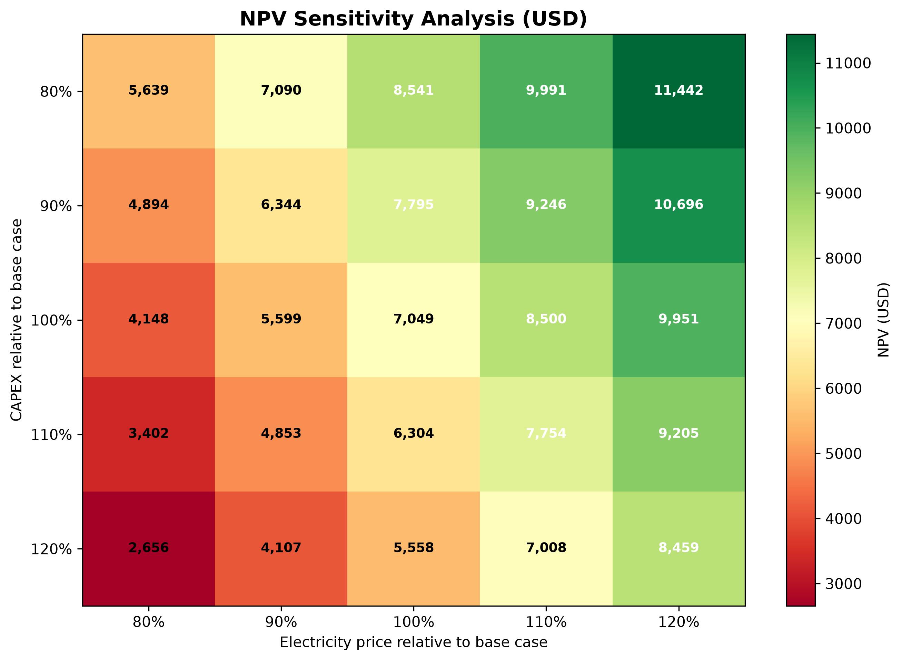

# PV Economic Appraisal

[](https://www.python.org/)
[](#license)

A transparent economic screening model for grid-connected solar photovoltaic (PV) investments. The project evaluates annual energy production and operating cash flows, then reports net present value (NPV), internal rate of return (IRR), and simple and discounted payback. It also provides a 5 × 5 NPV sensitivity analysis over capital cost and electricity price.

> **Scope.** Outputs are illustrative screening results, not investment advice, an engineering design, or a substitute for a project-specific financial assessment. Results depend on the assumptions and conventions documented below.

## Contents

- [Features](#features)
- [Repository structure](#repository-structure)
- [Requirements and setup](#requirements-and-setup)
- [Inputs and defaults](#inputs-and-defaults)
- [Methods](#methods)
- [Illustrative results](#illustrative-results)
- [NPV sensitivity analysis](#npv-sensitivity-analysis)
- [Figures](#figures)
- [Assumptions and limitations](#assumptions-and-limitations)
- [Reproducibility](#reproducibility)
- [Author](#author)
- [License](#license)

## Features

- Annual generation with compounded degradation.
- Annual revenue, operating and maintenance (O&M) costs, and net cash flows.
- NPV and IRR calculations, plus fractional simple and discounted payback.
- A 5 × 5 NPV sensitivity grid varying installed CAPEX and electricity price.
- Cash-flow and sensitivity visualizations.

## Repository structure

The working directory available when this README was prepared contained the README only; the model source, dependency manifest, and image assets were not present for inspection. The following is the intended repository-root layout implied by the documented project outputs. Add or retain these files in the GitHub repository for the setup instructions and embedded figures to work:

```text
pv-economic-appraisal/
├── README.md
├── pv_payback.py
├── requirements.txt
├── cumulative_cash_flow.png
└── npv_sensitivity_heatmap.png
```

The two figures are expected to be committed at the repository root for the relative Markdown image links below to render on GitHub. The author CV supplied separately is not a project dependency and is not part of this repository layout.

## Requirements and setup

Python 3.9 or later is recommended. From the repository root, install the dependencies and run the interactive model:

```bash
python -m pip install -r requirements.txt
python pv_payback.py
```

The program prompts for project assumptions. Pressing Enter is expected to select the defaults listed below; confirm prompt behavior against the current source before relying on it. `requirements.txt` should list the packages imported by the implementation (the documented plotting/calculation stack includes NumPy and Matplotlib).

## Inputs and defaults

| Input | Symbol | Default | Unit / interpretation |
|---|---:|---:|---|
| Installed capacity | $P$ | 10 | kW |
| Specific annual yield | $Y$ | 1,700 | kWh per kW per year |
| Installed cost | $C$ | 650 | USD per kW |
| Annual O&M rate | $m$ | 1.5% | Fraction of initial CAPEX per year |
| Electricity price | $p$ | 0.09 | USD per kWh |
| Annual generation degradation | $d$ | 0.5% | Annual compounded decline |
| Project life | $N$ | 20 | years |
| Discount rate | $r$ | 8% | Annual rate |

These values define the illustrative base case. Currency is USD throughout. Values are documentation assumptions and should be checked against the model's current prompts and validation rules before use.

## Methods

For capacity $P$, specific yield $Y$, installed cost $C$, O&M fraction $m$, electricity price $p$, degradation $d$, project life $N$, and discount rate $r$, initial investment and year-$t$ generation are:

$$\mathrm{CAPEX}=P C, \qquad G_t=P Y(1-d)^{t-1}, \quad t=1,\ldots,N.$$

Annual revenue, O&M, and operating net cash flow are:

$$\mathrm{Revenue}_t=G_t p, \qquad \mathrm{O\&M}_t=m\,\mathrm{CAPEX}, \qquad \mathrm{NCF}_t=\mathrm{Revenue}_t-\mathrm{O\&M}_t.$$

The initial cash flow is $\mathrm{NCF}_0=-\mathrm{CAPEX}$. NPV discounts end-of-year cash flows:

$$\mathrm{NPV}(r)=\sum_{t=0}^{N}\frac{\mathrm{NCF}_t}{(1+r)^t}.$$

IRR is the rate $r^*$ satisfying:

$$0=\sum_{t=0}^{N}\frac{\mathrm{NCF}_t}{(1+r^*)^t}.$$

Simple payback is the first point at which cumulative undiscounted operating cash flows recover initial CAPEX. Discounted payback uses the discounted operating cash flows $D_t=\mathrm{NCF}_t/(1+r)^t$. Where the threshold is crossed between annual periods, fractional payback linearly interpolates within the crossing year. If the threshold is never crossed during project life, payback is not achieved within the modeled period.

## Illustrative results

For the defaults above, the requested illustrative results are:

| Metric | Result |
|---|---:|
| System capacity | 10 kW |
| Initial CAPEX | $6,500.00 |
| First-year generation | 17,000 kWh |
| Annual O&M | $97.50 |
| Simple payback | 4.58 years |
| Discounted payback | 5.95 years |
| NPV at 8% | $7,049.24 |
| IRR | 21.07% |

Payback values are reported to two decimal places. They are presented as the requested illustrative results; because the source code was not available in the preparation workspace, their calculation and rounding could not be independently checked against the implementation.

## NPV sensitivity analysis

The table varies CAPEX and electricity price by factors of 0.80 to 1.20 in 0.10 increments. Rows indicate CAPEX multipliers and columns indicate electricity-price multipliers. Other assumptions are held at the base case, and O&M remains 1.5% of scenario CAPEX. Values are NPV in USD.

| CAPEX factor \ Price factor | 0.80 | 0.90 | 1.00 | 1.10 | 1.20 |
|---:|---:|---:|---:|---:|---:|
| **0.80** | $5,639.40 | $7,090.05 | $8,540.70 | $9,991.35 | $11,442.00 |
| **0.90** | $4,893.67 | $6,344.32 | $7,794.97 | $9,245.62 | $10,696.27 |
| **1.00** | $4,147.94 | $5,598.59 | **$7,049.24** | $8,499.90 | $9,950.55 |
| **1.10** | $3,402.21 | $4,852.87 | $6,303.52 | $7,754.17 | $9,204.82 |
| **1.20** | $2,656.49 | $4,107.14 | $5,557.79 | $7,008.44 | $8,459.09 |

## Figures

The links below use repository-root relative paths and are formatted for GitHub rendering. Commit the corresponding PNG files at those paths; they will otherwise appear as broken images.


*Figure 1. Cumulative cash flow over the modeled project life.*



*Figure 2. NPV sensitivity to installed CAPEX and electricity price.*

## Assumptions and limitations

- Generation declines by a constant compounded annual degradation rate.
- O&M is fixed in nominal terms and calculated as a fraction of initial (or scenario) CAPEX.
- Operating cash flows are received at year-end; the model uses annual periods.
- Taxes, inflation, financing structure, subsidies, replacement costs, residual value, and time-varying tariffs are excluded unless explicitly implemented.
- Sensitivity results cover only the stated CAPEX and electricity-price factors; they do not quantify uncertainty in resource, yield, or other inputs.
- IRR can be ambiguous or unavailable for some cash-flow profiles. Interpret it alongside NPV and the underlying assumptions.

No external benchmark or unsupported institutional citation is used here. For a real project, document the provenance, units, and date of every input and assess local tariff, interconnection, tax, and regulatory conditions.

## Reproducibility

For any reported analysis, record the exact inputs, Python version, dependency versions, and repository revision. Validate output metrics and generated plot files against the code version used. The numerical summary and sensitivity values above are illustrative documentation; the model source was not present in the workspace used to prepare this README, so source-level behavior and outputs have not been audited here.

## Author

**Mohammad Akbarzadeh**  
Ph.D. Candidate in Resource Economics  
Ferdowsi University of Mashhad 

## License

No license information was available in the preparation workspace. Add a `LICENSE` file and replace this note or the license badge with the repository's actual license before redistributing the software.
