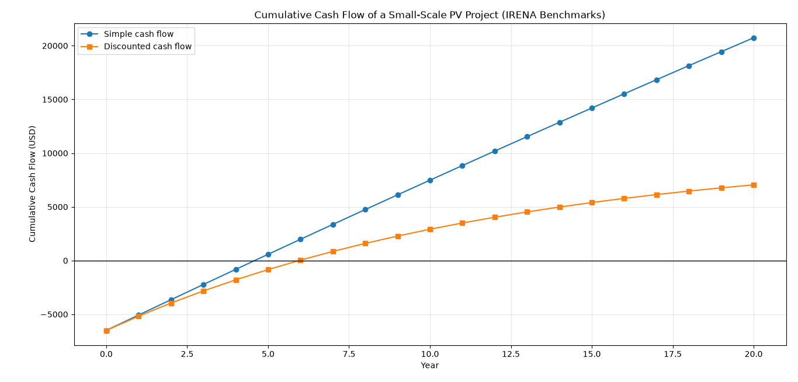

# Photovoltaic (PV) Economic Appraisal Model

[](LICENSE)
[](https://www.python.org/downloads/)

An interactive and transparent Python model for evaluating the financial performance of small-scale photovoltaic (PV) power plants. 

# PV Economic Appraisal

## Abstract

PV Economic Appraisal is a research-oriented, open-source framework for assessing the financial performance of a photovoltaic (PV) investment over a specified project lifetime. It combines user-supplied technical and economic assumptions to estimate annual electricity generation, operating costs, project cash flows, discounted indicators, and selected payback measures. The repository is intended to support transparent, reproducible scenario analysis; its outputs are conditional on the stated inputs and are not investment advice.

## Research Objective and Scope

The objective is to provide a clear and reproducible computational workflow for evaluating the economic attractiveness of a PV project under explicit assumptions. The analysis covers project-level capital expenditure, generation with annual degradation, electricity value, annual operation and maintenance (O&M), net cash flow, and standard discounted and undiscounted performance indicators.

The model is a deterministic appraisal of a single project. Unless explicitly implemented and documented, it does not represent taxes, financing structure, inflation, changing tariffs, equipment replacement, residual value, uncertainty, or grid constraints. Users should confirm the conventions and implementation in the source code before applying the results to a specific decision.

## Key Features

- Calculates installed-system CAPEX from capacity and unit cost.
- Estimates annual generation from specific yield and applies a degradation rate.
- Values generation at an electricity price and accounts for annual O&M.
- Reports net cash flow, NPV, IRR, simple payback, and discounted payback.
- Supports scenario and sensitivity analysis of selected inputs.
- Produces visual summaries, including cumulative cash flow and an NPV sensitivity heatmap, when those outputs are generated by the application.

## Repository Structure

The precise file inventory depends on the repository version. A typical layout is:

```text
pv-economic-appraisal/
├── README.md
├── requirements.txt
├── main.py                         # Application entry point (if present)
├── src/                            # Model and application modules (if present)
├── outputs/
│   ├── cumulative_cash_flow.png
│   └── npv_sensitivity_heatmap.png
└── tests/                           # Tests (if present)
```

The names above are illustrative where marked “if present.” Consult the actual repository tree for the authoritative entry point and output locations.

## Default Assumptions

| Parameter | Default value | Unit / interpretation |
|---|---:|---|
| Installed capacity | 10 | kW |
| CAPEX intensity | 650 | USD/kW |
| Initial investment | 6,500 | USD; capacity × CAPEX intensity |
| Specific yield | 1,700 | kWh/kW/year |
| First-year generation | 17,000 | kWh; capacity × specific yield |
| Annual O&M rate | 1.5% | Fraction of initial investment per year |
| Electricity price | 0.09 | USD/kWh |
| Annual degradation | 0.5% | Fractional reduction in generation per year |
| Project lifetime | 20 | years |
| Discount rate | 8% | Annual rate |

These values describe an illustrative base case, not a forecast or a universal benchmark. The interpretation of O&M escalation, timing conventions, and cash-flow sign conventions should be checked against the implementation.

## Methodology

Let capacity be \(K\) (kW), unit CAPEX \(c\) (USD/kW), specific yield \(Y\) (kWh/kW/year), annual degradation \(d\), electricity price \(p\) (USD/kWh), annual O&M rate \(m\), project lifetime \(T\) (years), and discount rate \(r\). Let \(t=1,\ldots,T\) denote operating years. The equations below state the appraisal conventions used to describe the model; confirm details such as year-zero timing and O&M escalation in code.

### Capital expenditure

Initial investment is calculated as:

\[
I_0 = Kc.
\]

For the default case, \(I_0=10\times650=\$6{,}500\). This representation treats CAPEX as a year-zero outflow and does not separately itemize components.

### Generation with degradation

First-year generation is:

\[
G_1 = KY.
\]

Generation in operating year \(t\) is:

\[
G_t = G_1(1-d)^{t-1}.
\]

Thus the default first-year generation is \(10\times1{,}700=17{,}000\) kWh. The exponent convention keeps year 1 at the undegraded baseline.

### Revenue

Annual electricity value (or gross revenue) is:

\[
R_t = pG_t.
\]

This assumes a constant real or nominal price consistent with the user's chosen currency basis; no price escalation is included in the equation.

### Operation and maintenance

Under the stated fixed-share convention:

\[
O_t = mI_0.
\]

The default annual O&M amount is \(0.015\times6{,}500=\$97.50\). If the implementation escalates O&M or calculates it on a different cost base, that implementation takes precedence and should be documented.

### Net cash flow

For operating year \(t\), net operating cash flow is:

\[
NCF_t = R_t-O_t.
\]

With initial investment represented separately, the project cash-flow series is \(CF_0=-I_0\) and \(CF_t=NCF_t\) for \(t\geq1\). Taxes, debt service, replacement costs, and terminal value are excluded unless added explicitly.

### Discounted cash flow and NPV

The present value of year-\(t\) cash flow at rate \(r\) is:

\[
PV_t = \frac{CF_t}{(1+r)^t}.
\]

Net present value is:

\[
NPV = \sum_{t=0}^{T}\frac{CF_t}{(1+r)^t}
    = -I_0 + \sum_{t=1}^{T}\frac{NCF_t}{(1+r)^t}.
\]

A positive NPV indicates that discounted project cash flows exceed the initial outlay under the chosen assumptions and discount rate. It does not establish that the assumptions are realistic.

### Internal rate of return

IRR is the rate \(i\) satisfying:

\[
0 = \sum_{t=0}^{T}\frac{CF_t}{(1+i)^t}.
\]

IRR may be non-unique or undefined for cash-flow sequences with multiple sign changes or no admissible root. Numerical implementations should report convergence failures rather than silently treating them as meaningful results.

### Simple payback

Simple payback is the first time cumulative undiscounted cash flow becomes non-negative. If the crossing occurs between years \(n\) and \(n+1\), linear interpolation gives:

\[
PBP = n + \frac{-\sum_{t=0}^{n}CF_t}{CF_{n+1}}.
\]

This interpolation assumes the year \(n+1\) net cash flow accrues uniformly during that year. If cumulative cash flow never reaches zero within the modeled lifetime, payback is not achieved within the horizon.

### Discounted payback

Discounted payback applies the same crossing convention to discounted cash flows \(PV_t\): it is the first time cumulative discounted cash flow becomes non-negative, with within-year interpolation where supported. It depends on the discount rate and can exceed the project lifetime or remain unreached.

## Illustrative Default-Case Results

The following results are the specified illustrative outputs for the default case. They are reported as reference values; exact reproduction depends on implementation details, including cash-flow timing, O&M treatment, rounding, and payback interpolation.

| Indicator | Illustrative result |
|---|---:|
| Initial investment | $6,500.00 |
| First-year generation | 17,000 kWh |
| Simple payback | 4.58 years |
| Discounted payback | 5.95 years |
| NPV at 8% | $7,049.24 |
| IRR | 21.07% |

Do not infer that the equations and conventions stated here necessarily reproduce every listed output unless they have been checked against the repository implementation.

## Sensitivity Analysis

Sensitivity analysis varies one or more selected assumptions while holding the remaining inputs fixed, then recalculates the target metric (commonly NPV). A heatmap can display NPV across two input dimensions, such as electricity price and CAPEX intensity. Read axes, units, baseline values, and color scale from the generated plot; a heatmap describes conditional model behavior, not probability or forecast confidence. For reproducibility, document the varied parameter ranges, grid resolution, and fixed assumptions alongside any reported sensitivity results.

## Generated Outputs

When generated and stored at the repository root, the following links display the requested figures. If files are stored in another directory, update the relative paths accordingly.

- Cumulative cash flow: 
- NPV sensitivity heatmap: 

The image links are relative to this README. Ensure the image files are committed at the corresponding paths for them to render on GitHub.

## Installation and Execution

The exact entry point and command-line interface depend on the checked-out repository version. From the repository root, a conventional Python workflow is:

```bash
python -m venv .venv
# Linux/macOS
source .venv/bin/activate
# Windows PowerShell: .venv\Scripts\Activate.ps1
python -m pip install --upgrade pip
python -m pip install -r requirements.txt
```

Run the entry point actually provided by the repository. For example, if it is `main.py`:

```bash
python main.py
```

If the project exposes a package or another script, use its documented invocation instead. Inspect generated files and application output to confirm the selected inputs and units.

## Requirements

A minimal `requirements.txt` template for a conventional numerical and plotting workflow is shown below. It is a template, not a verified dependency manifest: reconcile package names and versions with the imports and tested environment in the repository before use.

```text
numpy
pandas
matplotlib
seaborn
```

Use and document pinned or bounded versions for a controlled research environment. Add only dependencies required by the actual code.

## Input Validation and Units

Inputs should be finite numeric values in the units shown above. Capacity, CAPEX intensity, yield, price, lifetime, and discount rate must have consistent units and interpretation. Validate that capacity, unit CAPEX, yield, lifetime, and price are non-negative; lifetime should be a positive integer. For the conventional model, require \(0\leq d<1\), \(m\geq0\), and \(r>-1\). Reject missing values, non-finite values, and incompatible units. A zero electricity price or zero yield is mathematically possible but will generally eliminate operating revenue. Clearly state whether percentages are entered as percentages (e.g. `8`) or decimal fractions (e.g. `0.08`) in the user interface; the equations use decimal fractions.

Currency is expressed in USD in the illustrative case. No conversion date, inflation basis, or purchasing-power adjustment is implied. For comparisons across periods or jurisdictions, align all monetary inputs and the discount rate to the same nominal or real basis.

## Reproducibility Protocol

1. Record the source revision (Git commit), Python version, operating system, and dependency versions.
2. Save the complete input set, including units, scenario labels, and any non-default assumptions.
3. Run the documented entry point from a clean environment installed from the dependency manifest.
4. Retain raw numerical outputs as well as figures; record rounding and any random seeds if stochastic methods are introduced.
5. Recalculate key indicators independently from the exported annual cash-flow series and compare within an explicitly chosen numerical tolerance.
6. Archive the output files and a concise run log so another analyst can reproduce the results.

## Assumptions, Limitations, and Interpretation

- Results are scenario-dependent and should not be interpreted as financial, engineering, or policy advice.
- Constant prices and simplified O&M may not reflect market contracts, inflation, degradation-related maintenance, or changing operating costs.
- Specific yield is an aggregate assumption; it does not explicitly model location, weather variability, shading, curtailment, availability, or system losses unless implemented separately.
- Financing, taxes, incentives, insurance, replacement, decommissioning, salvage value, and working capital are outside the stated base scope.
- NPV is conditional on the discount rate and cash-flow perspective. The discount rate should correspond to the currency, inflation basis, risk, and project perspective used for cash flows.
- IRR can be misleading when cash flows are non-conventional and should be interpreted alongside NPV.
- Payback measures omit benefits and costs after the payback date and do not substitute for full-life-cycle appraisal.
- Illustrative results are not independently verified against a particular source-code implementation in this README; reconcile equations, timing, and outputs before citing or relying on them.

## Possible Extensions

Potential extensions include explicit financing and tax schedules; inflation-consistent real and nominal scenarios; time-varying electricity tariffs; component replacement and residual value; stochastic generation and price scenarios; Monte Carlo risk analysis; uncertainty intervals; location-specific yield inputs; comparison of project and equity cash flows; and automated tests for formulas, input validation, and reported indicators. Extensions should preserve transparent assumptions and reproducible outputs.

## Citation and Academic Use

This repository may be used for educational and research purposes subject to its license. Users should cite the repository version, access date, and any associated publication or archived release, where available. Clearly distinguish model outputs from empirical observations, disclose modifications and assumptions, and do not cite illustrative values as measured evidence. No specific external report or source is asserted here.

## Author

**Mohammad Akbarzadeh**  
Ph.D. Candidate in Resource Economics  
Ferdowsi University of Mashhad  
GitHub: [mahemay](https://github.com/mahemay)

## License

This project is distributed under the MIT License. The following is the standard MIT license text; replace the copyright year as appropriate for the repository.

```text
MIT License

Copyright (c) [YEAR] Mohammad Akbarzadeh

Permission is hereby granted, free of charge, to any person obtaining a copy
of this software and associated documentation files (the "Software"), to deal
in the Software without restriction, including without limitation the rights
to use, copy, modify, merge, publish, distribute, sublicense, and/or sell
copies of the Software, and to permit persons to whom the Software is
furnished to do so, subject to the following conditions:

The above copyright notice and this permission notice shall be included in all
copies or substantial portions of the Software.

THE SOFTWARE IS PROVIDED "AS IS", WITHOUT WARRANTY OF ANY KIND, EXPRESS OR
IMPLIED, INCLUDING BUT NOT LIMITED TO THE WARRANTIES OF MERCHANTABILITY,
FITNESS FOR A PARTICULAR PURPOSE AND NONINFRINGEMENT. IN NO EVENT SHALL THE
AUTHORS OR COPYRIGHT HOLDERS BE LIABLE FOR ANY CLAIM, DAMAGES OR OTHER
LIABILITY, WHETHER IN AN ACTION OF CONTRACT, TORT OR OTHERWISE, ARISING FROM,
OUT OF OR IN CONNECTION WITH THE SOFTWARE OR THE USE OR OTHER DEALINGS IN THE
SOFTWARE.
```
